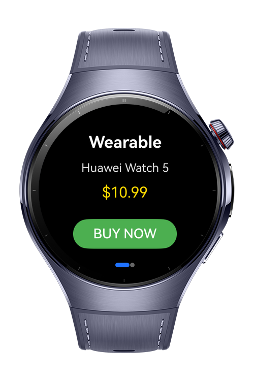

> **Note:** To access all shared projects, get information about environment setup, and view other guides, please visit [Explore-In-HMOS-Wearable Index](https://github.com/Explore-In-HMOS-Wearable/hmos-index).

# How to create purchase with IAP Kit
This codelab demonstrates how to integrate In-App Purchases (IAP Kit) in a HarmonyOS application by implementing a clean and secure createPurchase() flow.
The goal is to provide a simple, reusable purchase method that can be integrated into any app, especially wearable-first experiences such as digital goods, upgrades, or subscription features.

In this guide, you will learn how to initialize IAP Kit, request a purchase, handle the transaction result, and update your app state—all through a single function.

# Preview

<div>
  
  
</div>

# Use Cases

1. Apps can offer digital items such as premium features, currency packs, unlocks, or consumables using a secure IAP process.
2. Users can purchase products directly inside the app through a clean, unified method (createPurchase()), simplifying the overall IAP workflow.
3. The application can easily track purchase success, failure, or cancellation and update UI or ViewModel states accordingly.

# Technology

## Stack

- **Languages**: ArkTS, ArkUI
- **Frameworks**: HarmonyOS 5.1.0(18)
- **Tools**: DevEco Studio Vers 5.1.0.828SP1,
- **Libraries**: @kit.IAPKit @kit.ArkUI

## Required Permissions

- `ohos.permission.INTERNET`
  > Required to access the IAP service backend.
- `ohos.permission.GET_NETWORK_INFO`
  > Needed to ensure the device has valid network access before initiating purchase.


# Directory Structure

```
│
├───entryability
│       EntryAbility.ets
│
├───pages
│       Index.ets

```

# Constraints and Restrictions

## Suported Devices

- Huawei Watch 5

## Limitations

- IAP purchase flows cannot be tested on Previewer or Emulator
- Must be tested on a real device with Huawei Account logged in.
- Products must be configured in AppGallery Connect → Products section before purchase will work.
- Network access is required for every purchase request.

# License

**HowToCreatePurchase** is distributed under the terms of the MIT License
See the [LICENSE](LICENSE) for more information.


